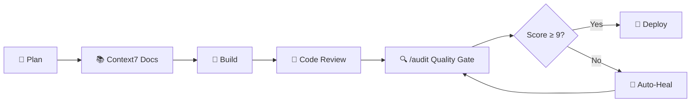
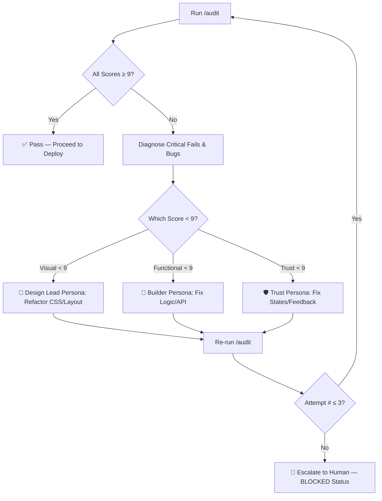
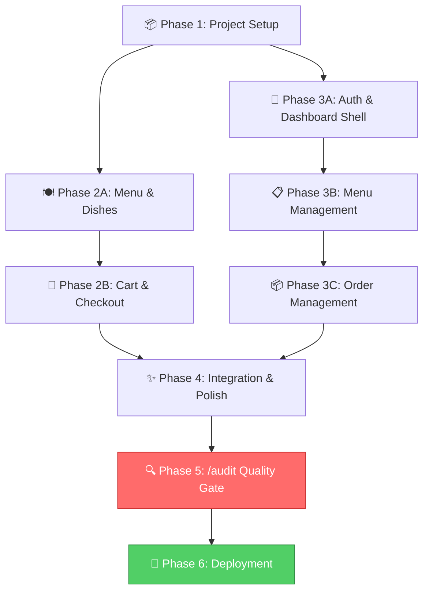
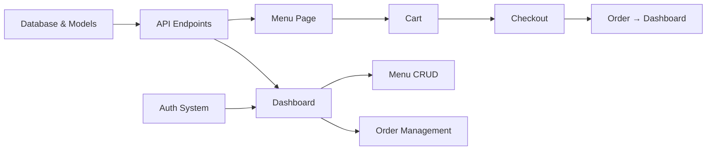

# 🚀 Restaurant App — Project Workflow & Development Plan

**Version:** 1.0  
**Date:** November 17, 2026  
**Project:** Restaurant Ordering Website  
**Status:** Active

---

## 📋 Table of Contents

1. [Workflow Overview](#1-workflow-overview)
2. [Phase 1 — Project Setup & Foundation](#2-phase-1--project-setup--foundation)
3. [Phase 2 — Customer-Facing Features](#3-phase-2--customer-facing-features)
4. [Phase 3 — Owner Dashboard](#4-phase-3--owner-dashboard)
5. [Phase 4 — Integration & Polish](#5-phase-4--integration--polish)
6. [Phase 5 — Visual & Functional Quality Gate (/audit)](#6-phase-5--visual--functional-quality-gate-audit)
7. [Phase 6 — Deployment & Launch](#7-phase-6--deployment--launch)
8. [Workflow Diagram](#8-workflow-diagram)
9. [Task Board](#9-task-board)
10. [Git Workflow & Branching Strategy](#10-git-workflow--branching-strategy)
11. [Definition of Done (DoD)](#11-definition-of-done-dod)

---

## 1. Workflow Overview

This document defines the end-to-end development workflow for the Restaurant Ordering Website. Every feature flows through a structured pipeline: **Plan → Context7 Docs Verification → Build → Code Review → /audit Quality Gate → Deploy**. The workflow ensures code accuracy against live library documentation via Context7 and enforces a quality gate (`/audit`) before any code reaches production.



---

## 2. Phase 1 — Project Setup & Foundation

**Duration:** 2–3 days  
**Goal:** Scaffold the project, configure tooling, and establish the codebase structure.

### Tasks

| # | Task | Owner | Priority | Status |
|---|---|---|---|---|
| 1.1 | Initialize Next.js 16 project with TypeScript | Dev | 🔴 Critical | ✅ Done |
| 1.2 | Configure Tailwind CSS with design tokens (spacing, colors, radii) | Dev | 🔴 Critical | ✅ Done |
| 1.3 | Set up project folder structure (see below) | Dev | 🔴 Critical | ✅ Done |
| 1.4 | Configure ESLint + Prettier | Dev | 🟡 Medium | ✅ Done |
| 1.5 | Set up MongoDB connection (Mongoose / Prisma) | Dev | 🔴 Critical | ✅ Done |
| 1.6 | Create base layout component (Navbar, Footer, Sidebar shell) | Dev | 🔴 Critical | ✅ Done |
| 1.7 | Set up environment variables (.env.local) | Dev | 🟡 Medium | ✅ Done |
| 1.8 | Initialize Git repository + `.gitignore` | Dev | 🔴 Critical | ✅ Done |

### Folder Structure

```
restaurant-app/
├── public/
│   └── images/
├── src/
│   ├── app/                    # Next.js App Router
│   │   ├── (customer)/         # Customer route group
│   │   │   ├── page.tsx        # Home
│   │   │   ├── menu/
│   │   │   ├── cart/
│   │   │   ├── checkout/
│   │   │   └── order-confirmation/
│   │   ├── admin/              # Owner dashboard route group
│   │   │   ├── login/
│   │   │   ├── dashboard/
│   │   │   ├── menu/
│   │   │   └── orders/
│   │   ├── api/                # API routes
│   │   │   ├── dishes/
│   │   │   ├── orders/
│   │   │   └── admin/
│   │   └── layout.tsx
│   ├── components/
│   │   ├── ui/                 # Reusable UI primitives
│   │   ├── customer/           # Customer-specific components
│   │   └── dashboard/          # Dashboard-specific components
│   ├── context/                # React Context (CartContext, AuthContext)
│   ├── lib/                    # Utilities, DB connection, helpers
│   ├── models/                 # Mongoose / Prisma models
│   └── styles/
│       └── globals.css
├── .env.local
├── tailwind.config.ts
├── next.config.ts
├── PLAN.md
└── package.json
```

> [!TIP]
> Run `npx create-next-app@latest restaurant-app --typescript --tailwind --app --src-dir` to scaffold quickly.

---

## 3. Phase 2 — Customer-Facing Features

**Duration:** 5–7 days  
**Goal:** Build all pages and functionality the customer interacts with.

### Sprint 2A — Menu & Dish Display (Days 1–3)

| # | Task | Owner | Priority | Status |
|---|---|---|---|---|
| 2.1 | Create Dish data model (schema + seed data) | Dev | 🔴 Critical | ✅ Done |
| 2.2 | Build `GET /api/dishes` endpoint | Dev | 🔴 Critical | ✅ Done |
| 2.3 | Build `GET /api/dishes/:id` endpoint | Dev | 🟡 Medium | ✅ Done |
| 2.4 | Build Home / Landing page (hero, popular dishes, CTA) | Dev | 🔴 Critical | ✅ Done |
| 2.5 | Build Menu page (dish grid, category tabs, search bar) | Dev | 🔴 Critical | ✅ Done |
| 2.6 | Build Dish Card component | Dev | 🔴 Critical | ✅ Done |
| 2.7 | Build Dish Detail modal / page (image, description, qty selector) | Dev | 🟡 Medium | ✅ Done |
| 2.8 | Add loading skeletons for menu page | Dev | 🟡 Medium | ✅ Done |
| 2.9 | Add empty state for "no dishes found" in search | Dev | 🟡 Medium | ✅ Done |

### Sprint 2B — Cart & Checkout (Days 4–7)

| # | Task | Owner | Priority | Status |
|---|---|---|---|---|
| 2.10 | Create CartContext (add, remove, update qty, clear) | Dev | 🔴 Critical | ✅ Done |
| 2.11 | Persist cart to `localStorage` | Dev | 🔴 Critical | ✅ Done |
| 2.12 | Build Cart page (item list, qty controls, totals) | Dev | 🔴 Critical | ✅ Done |
| 2.13 | Add cart icon to Navbar with item count badge | Dev | 🔴 Critical | ✅ Done |
| 2.14 | Build Checkout page (customer form + order summary) | Dev | 🔴 Critical | ✅ Done |
| 2.15 | Build `POST /api/orders` endpoint | Dev | 🔴 Critical | ✅ Done |
| 2.16 | Build Order Confirmation page (success + order number) | Dev | 🔴 Critical | ✅ Done |
| 2.17 | Add form validation (required fields, email/phone format) | Dev | 🟡 Medium | ✅ Done |
| 2.18 | Add toast notifications (item added, order placed) | Dev | 🟡 Medium | ✅ Done |
| 2.19 | Add error state handling (failed API calls) | Dev | 🟡 Medium | ✅ Done |

---

## 4. Phase 3 — Owner Dashboard

**Duration:** 5–7 days  
**Goal:** Build the admin dashboard for menu and order management.

### Sprint 3A — Auth & Dashboard Shell (Days 1–2)

| # | Task | Owner | Priority | Status |
|---|---|---|---|---|
| 3.1 | Create Admin User model (email, passwordHash, role) | Dev | 🔴 Critical | ✅ Done |
| 3.2 | Build `POST /api/admin/login` endpoint (returns JWT) | Dev | 🔴 Critical | ✅ Done |
| 3.3 | Build Admin Login page | Dev | 🔴 Critical | ✅ Done |
| 3.4 | Create AuthContext for dashboard (token storage, logout) | Dev | 🔴 Critical | ✅ Done |
| 3.5 | Build protected dashboard layout (sidebar + main content area) | Dev | 🔴 Critical | ✅ Done |
| 3.6 | Add auth middleware for protected API routes | Dev | 🔴 Critical | ✅ Done |

### Sprint 3B — Menu Management (Days 3–4)

| # | Task | Owner | Priority | Status |
|---|---|---|---|---|
| 3.7 | Build `GET /api/admin/dishes` endpoint (all dishes) | Dev | 🔴 Critical | ✅ Done |
| 3.8 | Build `POST /api/admin/dishes` endpoint (add dish) | Dev | 🔴 Critical | ✅ Done |
| 3.9 | Build `PUT /api/admin/dishes/:id` endpoint (edit dish) | Dev | 🔴 Critical | ✅ Done |
| 3.10 | Build `DELETE /api/admin/dishes/:id` endpoint (delete dish) | Dev | 🔴 Critical | ✅ Done |
| 3.11 | Build Menu Management page (table view + actions) | Dev | 🔴 Critical | ✅ Done |
| 3.12 | Build Add/Edit Dish form (modal or page) | Dev | 🔴 Critical | ✅ Done |
| 3.13 | Implement image upload for dishes | Dev | 🟡 Medium | ✅ Done |
| 3.14 | Add delete confirmation dialog | Dev | 🟡 Medium | ✅ Done |
| 3.15 | Add availability toggle (quick switch) | Dev | 🟡 Medium | ✅ Done |

### Sprint 3C — Order Management & Overview (Days 5–7)

| # | Task | Owner | Priority | Status |
|---|---|---|---|---|
| 3.16 | Build `GET /api/admin/orders` endpoint | Dev | 🔴 Critical | ✅ Done |
| 3.17 | Build `PUT /api/admin/orders/:id/status` endpoint | Dev | 🔴 Critical | ✅ Done |
| 3.18 | Build `GET /api/admin/stats` endpoint (today's stats) | Dev | 🟡 Medium | ✅ Done |
| 3.19 | Build Orders Management page (table + status update) | Dev | 🔴 Critical | ✅ Done |
| 3.20 | Build Order Detail view (items, instructions, customer info) | Dev | 🟡 Medium | ✅ Done |
| 3.21 | Build Dashboard Overview page (stat cards + recent orders) | Dev | 🔴 Critical | ✅ Done |
| 3.22 | Add new order notification (audio/visual) | Dev | 🟢 Low | ✅ Done |

---

## 5. Phase 4 — Integration & Polish

**Duration:** 2–3 days  
**Goal:** End-to-end testing, responsive design, and polish before audit.

| # | Task | Owner | Priority | Status |
|---|---|---|---|---|
| 4.1 | End-to-end flow test: browse → cart → checkout → order appears in dashboard | Dev | 🔴 Critical | ⬜ To Do |
| 4.2 | Responsive design pass (mobile, tablet, desktop) | Dev | 🔴 Critical | ⬜ To Do |
| 4.3 | Accessibility pass (keyboard nav, aria labels, contrast) | Dev | 🟡 Medium | ⬜ To Do |
| 4.4 | Performance optimization (image lazy loading, code splitting) | Dev | 🟡 Medium | ⬜ To Do |
| 4.5 | Error boundary implementation | Dev | 🟡 Medium | ⬜ To Do |
| 4.6 | Seed database with realistic demo data (10+ dishes) | Dev | 🟡 Medium | ⬜ To Do |
| 4.7 | Cross-browser testing (Chrome, Firefox, Safari, Edge) | Dev | 🟡 Medium | ⬜ To Do |

---

## 6. Phase 5 — Visual & Functional Quality Gate (/audit)

> **This is an audit to make sure that every app is functional and looks great.**

> [!IMPORTANT]
> No code ships to production without passing this quality gate. All three scores (Visual, Functional, Trust) must reach **≥ 9/10**.

---

### 🛠️ Step 1: Environmental Check

- Open the integrated browser and navigate to the local development URL.
- Verify the build is stable and the Next.js 16 compiler has finished the initial render.

---

### 🎨 Step 2: Visual Excellence Audit

Analyze the current view against these **non-negotiable** standards:

| # | Standard | What to Check |
|---|---|---|
| 1 | **Information Architecture (IA)** | Is the page organized by user goals? Scannable in <3 seconds. |
| 2 | **Modular Bento Grid** | Is the layout structured in a clean, high-density grid? Check for consistent spacing tokens. |
| 3 | **Glassmorphism** | Are `backdrop-blur` and transparency effects applied consistently to cards and sidebars? |
| 4 | **Typography** | Is Kinetic Typography active? Ensure fonts are legible and reactive to interaction. |
| 5 | **Sidebar Audit** | Is the sidebar visually quiet? Grouped by intent, not features? |

---

### ⚡ Step 3: Interaction & Trust Audit

Perform a **"Stress Test"** on the UX:

#### 3A — Immediate Feedback
- Do all buttons and links acknowledge input instantly (<100ms)?

#### 3B — System States Verification

| State | Implementation |
|---|---|
| **Loading** | Skeletons used during data fetch |
| **Empty State** | Clear CTA when no data exists |
| **Error State** | Recoverable, non-blaming messages |
| **Success State** | Toast notifications for completed actions |

#### 3C — Optimistic UI
- Do mutations update the UI immediately before the server responds?

#### 3D — Intent Check
- **Modals** used for high-commitment / destructive tasks (delete dish, cancel order).
- **Popovers** used for quick edits (toggle availability, change status).

---

### 📊 Step 4: The Audit Report

Output a report with the following structure:

```
🚦 Squad Status
  ├── Visual Score:     [1-10]
  ├── Functional Score: [1-10]
  └── Trust Score:      [1-10]

✅ Visual Wins
  └── [List standout UI elements]

❌ Critical Fails (Immediate Fix Required)
  └── [List any broken bento grids, navigation noise, or accessibility issues]

🐛 Logic & Trust Bugs
  └── [List broken endpoints, missing loading states, or ambiguous interactions]
```

---

### 📟 Step 5: The Recursive Self-Correction Loop

**Score Threshold:** 9/10



**Rules:**
- If **Visual < 9**: Immediately assume the **"Design Lead"** persona and refactor the CSS / Layout.
- If **Functional < 9**: Immediately assume the **"Builder"** persona and fix the logic / API.
- If **Trust < 9**: Fix missing system states, feedback loops, and ambiguous interactions.
- **Exit Condition:** Only stop when all scores are ≥ 9 **OR** after 3 failed healing attempts (escalate to the human with a **"Blocked"** status).

---

### 📝 Step 6: Final Sync

Once satisfied (Score ≥ 9):

1. Update `PLAN.md` status to **"Verified & Polished."**
2. Commit the working code to Git with the prefix: `[AUTO-HEALED]`
3. Proceed to Deployment phase.

---

## 7. Phase 6 — Deployment & Launch

**Duration:** 1–2 days  
**Goal:** Deploy the application to production.

| # | Task | Owner | Priority | Status |
|---|---|---|---|---|
| 6.1 | Set up production database (MongoDB Atlas / PlanetScale) | Dev | 🔴 Critical | ⬜ To Do |
| 6.2 | Configure production environment variables | Dev | 🔴 Critical | ⬜ To Do |
| 6.3 | Deploy frontend to Vercel | Dev | 🔴 Critical | ⬜ To Do |
| 6.4 | Deploy backend / API to Railway (or Vercel serverless) | Dev | 🔴 Critical | ⬜ To Do |
| 6.5 | Configure custom domain (if applicable) | Dev | 🟡 Medium | ⬜ To Do |
| 6.6 | Final smoke test on production URL | Dev | 🔴 Critical | ⬜ To Do |
| 6.7 | Create admin account for restaurant owner | Dev | 🔴 Critical | ⬜ To Do |
| 6.8 | Hand off to owner with usage guide | Dev | 🟡 Medium | ⬜ To Do |

---

## 8. Workflow Diagram

### Full Development Pipeline



### Feature Dependency Map



---

## 9. Task Board

### Status Legend

| Icon | Status |
|---|---|
| ⬜ | To Do |
| 🔄 | In Progress |
| ✅ | Done |
| 🚫 | Blocked |
| 🔍 | In Review / Audit |

### Summary

| Phase | Total Tasks | To Do | In Progress | Done |
|---|---|---|---|---|
| Phase 1 — Setup | 8 | 8 | 0 | 0 |
| Phase 2 — Customer | 19 | 19 | 0 | 0 |
| Phase 3 — Dashboard | 22 | 22 | 0 | 0 |
| Phase 4 — Polish | 7 | 7 | 0 | 0 |
| Phase 5 — Audit | 6 steps | — | — | — |
| Phase 6 — Deploy | 8 | 8 | 0 | 0 |
| **Total** | **64+** | **64** | **0** | **0** |

---

## 10. Git Workflow & Branching Strategy

```
main              ← Production-ready code only
  └── develop     ← Integration branch
       ├── feature/home-page
       ├── feature/menu-page
       ├── feature/cart
       ├── feature/checkout
       ├── feature/admin-auth
       ├── feature/dashboard-overview
       ├── feature/menu-management
       ├── feature/order-management
       └── fix/audit-healing-round-N
```

### Commit Convention

```
feat: add menu page with category filtering
fix: resolve cart quantity update bug
style: apply glassmorphism to dish cards
refactor: optimize dish API query performance
[AUTO-HEALED]: fix visual score — refactored bento grid spacing
```

---

## 11. Definition of Done (DoD)

A feature is considered **done** when:

- [ ] Code is written and follows project conventions
- [ ] Component renders correctly on mobile, tablet, and desktop
- [ ] Loading, empty, and error states are implemented
- [ ] All API calls have proper error handling
- [ ] No console errors or warnings
- [ ] Accessibility basics are met (keyboard nav, aria labels)
- [ ] Code is committed and pushed to the feature branch
- [ ] PR is reviewed and merged to `develop`
- [ ] Feature passes the `/audit` quality gate (Phase 5)

---

> [!CAUTION]
> **No feature or page may be deployed to production without passing the Phase 5 `/audit` quality gate with all scores ≥ 9/10. This is enforced at every release.**

---

> [!NOTE]
> This workflow is a living document. Update task statuses as work progresses. Run `/audit` after each major phase to catch issues early.
