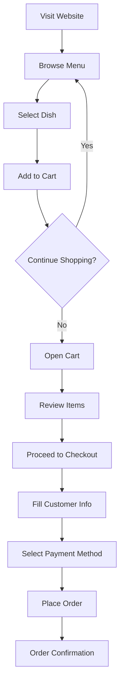
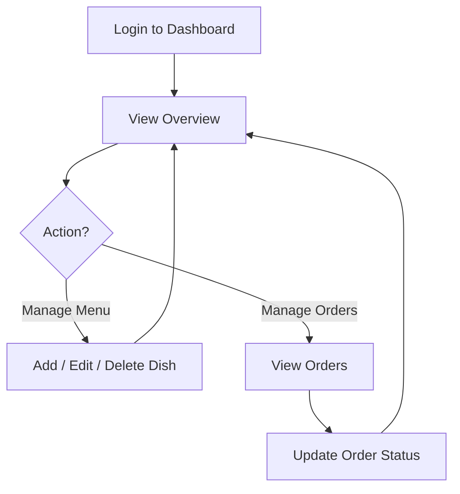

# 🍽️ Restaurant Ordering Website — Product Design Document

**Version:** 1.0  
**Date:** November 14, 2026  
**Author:** Product Team  
**Status:** Draft

---

## 1. Overview

### 1.1 Product Summary

A simple, responsive web application that allows a restaurant to showcase its menu online, enabling customers to browse dishes, add items to a cart, and place orders. The restaurant owner has access to a dedicated dashboard to manage the menu, view incoming orders, and track business activity.

### 1.2 Goals

- Provide customers with a clean, easy-to-use interface to browse and order food.
- Give the restaurant owner full control over the menu and orders through a dashboard.
- Streamline the ordering process with a cart and checkout flow.

### 1.3 Target Users

| User Type | Description |
|---|---|
| **Customer** | A person browsing the restaurant menu and placing an order. |
| **Owner / Admin** | The restaurant owner or manager who manages the menu and processes orders. |

---

## 2. Feature Breakdown

### 2.1 Customer-Facing Features

#### 2.1.1 Home / Landing Page

- Restaurant name, logo, and a hero banner image.
- Brief description / tagline of the restaurant.
- Navigation links: **Menu**, **Cart**, **About**, **Contact**.
- Call-to-action button: "View Our Menu".

#### 2.1.2 Menu Page

- Displays all available dishes organized by **category** (e.g., Appetizers, Main Course, Desserts, Drinks).
- Each dish card shows:
  - Dish image
  - Dish name
  - Short description
  - Price
  - **"Add to Cart"** button
- Category filter / tabs to quickly jump between sections.
- Search bar to find a specific dish by name.

#### 2.1.3 Dish Detail (Optional Modal / Page)

- Larger image of the dish.
- Full description and ingredients.
- Quantity selector.
- Special instructions text field (e.g., "no onions").
- **"Add to Cart"** button.

#### 2.1.4 Cart

- Accessible via a cart icon in the navbar (shows item count badge).
- Cart page / slide-out panel displays:
  - List of added items with image, name, quantity, and subtotal.
  - Ability to **increase / decrease quantity** or **remove** an item.
  - **Order subtotal**, tax, and **total** summary.
  - **"Proceed to Checkout"** button.
  - **"Continue Shopping"** link back to the menu.

#### 2.1.5 Checkout Page

- **Customer Information Form:**
  - Full name
  - Phone number
  - Email address
  - Delivery address (if delivery is supported) or pickup option
- **Order Summary:** Read-only recap of cart items and total.
- **Payment Method Selection:**
  - Cash on Delivery
  - Online Payment (card / wallet — future phase)
- **"Place Order"** button.
- **Order Confirmation Screen:**
  - Success message with order number.
  - Estimated preparation / delivery time.
  - Option to go back to the menu.

---

### 2.2 Owner Dashboard

> [!IMPORTANT]
> The dashboard is **password-protected** and accessible only to the restaurant owner/admin via a login page.

#### 2.2.1 Dashboard Login

- Simple login form: email + password.
- Authentication with session/token management.

#### 2.2.2 Dashboard Home (Overview)

- Summary cards:
  - Total orders today
  - Revenue today
  - Pending orders
  - Total menu items
- Recent orders list (last 10).

#### 2.2.3 Menu Management

- **View all dishes** in a table with columns: Image, Name, Category, Price, Status (Available / Unavailable), Actions.
- **Add New Dish:**
  - Name, description, price, category (dropdown), image upload, availability toggle.
- **Edit Dish:** Pre-filled form to update any field.
- **Delete Dish:** Confirmation dialog before deletion.
- **Toggle Availability:** Quick switch to mark a dish as unavailable without deleting it.

#### 2.2.4 Order Management

- Table of all orders with columns: Order #, Customer Name, Items, Total, Status, Date/Time, Actions.
- **Order Statuses:**
  - `New` → `Preparing` → `Ready` → `Completed`
  - `Cancelled`
- Owner can **update the status** of each order via a dropdown or buttons.
- Click an order row to view **full order details** (items, quantities, special instructions, customer info).

#### 2.2.5 Settings (Future Phase)

- Update restaurant name, logo, contact info.
- Set operating hours.
- Configure delivery zones and fees.

---

## 3. User Flows

### 3.1 Customer Order Flow



### 3.2 Owner Dashboard Flow



---

## 4. Information Architecture

```
/ (Home)
├── /menu                     → Menu listing page
│   └── /menu/:id             → Dish detail (optional)
├── /cart                     → Shopping cart
├── /checkout                 → Checkout form
├── /order-confirmation/:id   → Order success page
├── /admin/login              → Dashboard login
└── /admin/dashboard          → Dashboard (protected)
    ├── /admin/menu           → Menu management
    ├── /admin/orders          → Order management
    └── /admin/settings        → Settings (future)
```

---

## 5. Data Models

### 5.1 Dish

| Field | Type | Description |
|---|---|---|
| id | String / UUID | Unique identifier |
| name | String | Dish name |
| description | String | Short description |
| price | Number | Price in local currency |
| category | String | e.g., Appetizer, Main, Dessert, Drink |
| image | String (URL) | Path to dish image |
| available | Boolean | Whether the dish is currently offered |
| createdAt | DateTime | Date the dish was added |

### 5.2 Order

| Field | Type | Description |
|---|---|---|
| id | String / UUID | Unique order number |
| customerName | String | Customer full name |
| customerPhone | String | Contact phone number |
| customerEmail | String | Contact email |
| deliveryAddress | String | Delivery address (or "Pickup") |
| items | Array of OrderItem | List of ordered dishes |
| subtotal | Number | Sum before tax |
| tax | Number | Tax amount |
| total | Number | Final total |
| paymentMethod | String | "cash" or "online" |
| status | String | New / Preparing / Ready / Completed / Cancelled |
| createdAt | DateTime | When the order was placed |

### 5.3 OrderItem

| Field | Type | Description |
|---|---|---|
| dishId | String | Reference to the dish |
| name | String | Dish name (snapshot at order time) |
| price | Number | Price at order time |
| quantity | Number | Number ordered |
| specialInstructions | String | Customer notes |

### 5.4 Admin User

| Field | Type | Description |
|---|---|---|
| id | String / UUID | Unique identifier |
| email | String | Login email |
| passwordHash | String | Hashed password |
| role | String | "owner" or "admin" |

---

## 6. Wireframes (Descriptions)

### 6.1 Home Page

```
┌──────────────────────────────────────────────┐
│  LOGO        Menu    Cart(3)    About         │
├──────────────────────────────────────────────┤
│                                              │
│          🍕  Welcome to [Restaurant]          │
│       Fresh food, delivered to your door      │
│                                              │
│            [ View Our Menu ]                 │
│                                              │
├──────────────────────────────────────────────┤
│  Popular Dishes                              │
│  ┌────┐  ┌────┐  ┌────┐  ┌────┐             │
│  │IMG │  │IMG │  │IMG │  │IMG │              │
│  │Name│  │Name│  │Name│  │Name│              │
│  │ $$ │  │ $$ │  │ $$ │  │ $$ │              │
│  └────┘  └────┘  └────┘  └────┘             │
├──────────────────────────────────────────────┤
│  Footer: © 2026 Restaurant | Contact        │
└──────────────────────────────────────────────┘
```

### 6.2 Menu Page

```
┌──────────────────────────────────────────────┐
│  LOGO        Menu    Cart(3)    About         │
├──────────────────────────────────────────────┤
│  [Search dishes...]                          │
│  [ All ] [ Appetizers ] [ Main ] [ Desserts ]│
├──────────────────────────────────────────────┤
│  ┌──────────┐  ┌──────────┐  ┌──────────┐   │
│  │  IMAGE   │  │  IMAGE   │  │  IMAGE   │   │
│  │  Name    │  │  Name    │  │  Name    │   │
│  │  Desc... │  │  Desc... │  │  Desc... │   │
│  │  $12.99  │  │  $8.99   │  │  $15.00  │   │
│  │[Add Cart]│  │[Add Cart]│  │[Add Cart]│   │
│  └──────────┘  └──────────┘  └──────────┘   │
└──────────────────────────────────────────────┘
```

### 6.3 Cart

```
┌──────────────────────────────────────────────┐
│  Your Cart                                   │
├──────────────────────────────────────────────┤
│  IMG  Dish Name       [-] 2 [+]    $25.98    │
│  IMG  Another Dish    [-] 1 [+]    $8.99  🗑 │
├──────────────────────────────────────────────┤
│                        Subtotal:   $34.97    │
│                        Tax (10%):   $3.50    │
│                        Total:      $38.47    │
│                                              │
│  [Continue Shopping]    [Proceed to Checkout] │
└──────────────────────────────────────────────┘
```

### 6.4 Owner Dashboard

```
┌────────┬─────────────────────────────────────┐
│ SIDEBAR│  Dashboard Overview                 │
│        ├─────────────────────────────────────┤
│ Overview│ ┌──────┐ ┌──────┐ ┌──────┐ ┌─────┐│
│ Menu   │ │Orders│ │Revenue│ │Pending│ │Items││
│ Orders │ │  24  │ │ $580 │ │   3  │ │ 18 ││
│ Settings│ └──────┘ └──────┘ └──────┘ └─────┘│
│        ├─────────────────────────────────────┤
│ Logout │ Recent Orders                       │
│        │ #101  John   3 items  $38  Preparing│
│        │ #100  Sara   1 item   $12  Ready    │
│        │ #099  Mike   2 items  $22  Completed│
└────────┴─────────────────────────────────────┘
```

---

## 7. Tech Stack (Recommended)

| Layer | Technology | Reason |
|---|---|---|
| **Frontend** | React.js (or Next.js) | Component-based, fast rendering |
| **Styling** | Tailwind CSS | Rapid, utility-first styling |
| **State (Cart)** | React Context / Zustand | Lightweight global state for cart |
| **Backend** | Node.js + Express | Simple REST API server |
| **Database** | MongoDB (or PostgreSQL) | Flexible document store / relational |
| **Auth** | JWT (JSON Web Tokens) | Stateless dashboard authentication |
| **Image Storage** | Cloudinary or local `/uploads` | Dish image hosting |
| **Deployment** | Vercel (frontend) + Railway (backend) | Easy, free-tier friendly |

---

## 8. API Endpoints (REST)

### Public (Customer)

| Method | Endpoint | Description |
|---|---|---|
| GET | `/api/dishes` | Get all available dishes |
| GET | `/api/dishes/:id` | Get a single dish by ID |
| POST | `/api/orders` | Place a new order |
| GET | `/api/orders/:id` | Get order status by ID |

### Protected (Owner — requires auth token)

| Method | Endpoint | Description |
|---|---|---|
| POST | `/api/admin/login` | Admin login, returns JWT |
| GET | `/api/admin/dishes` | Get all dishes (inc. unavailable) |
| POST | `/api/admin/dishes` | Add a new dish |
| PUT | `/api/admin/dishes/:id` | Update a dish |
| DELETE | `/api/admin/dishes/:id` | Delete a dish |
| GET | `/api/admin/orders` | Get all orders |
| PUT | `/api/admin/orders/:id/status` | Update order status |
| GET | `/api/admin/stats` | Get dashboard summary stats |

---

## 9. Non-Functional Requirements

| Requirement | Target |
|---|---|
| **Responsiveness** | Fully responsive — mobile, tablet, desktop |
| **Performance** | Menu page loads in under 2 seconds |
| **Browser Support** | Chrome, Firefox, Safari, Edge (latest 2 versions) |
| **Accessibility** | WCAG 2.1 AA compliance |
| **Security** | Passwords hashed (bcrypt), JWT auth, input sanitization |
| **Scalability** | Handle up to 500 concurrent users initially |

---

## 10. Milestones & Phases

### Phase 1 — MVP (Core)

- [x] Home / Landing page
- [x] Menu page with categories and search
- [x] Cart functionality (add, remove, update quantity)
- [x] Checkout page with customer form
- [x] Order confirmation
- [x] Owner login
- [x] Dashboard overview
- [x] Menu management (CRUD)
- [x] Order management with status updates

### Phase 2 — Enhancements

- [ ] Online payment integration (Stripe / PayPal)
- [ ] Email / SMS order notifications
- [ ] Customer accounts and order history
- [ ] Dish ratings and reviews
- [ ] Restaurant settings page

### Phase 3 — Advanced

- [ ] Real-time order tracking (WebSocket)
- [ ] Multiple restaurant support (multi-tenant)
- [ ] Analytics dashboard (charts, top dishes, peak hours)
- [ ] Promo codes and discounts
- [ ] Mobile app (React Native)

---

## 11. Success Metrics

| Metric | Target |
|---|---|
| Order completion rate | > 70% of carts result in a placed order |
| Average page load time | < 2 seconds |
| Owner adoption | Owner logs into dashboard daily |
| Customer satisfaction | Positive feedback on ease of ordering |
| Order errors | < 2% incorrect or missed orders |

---

## 12. Risks & Mitigations

| Risk | Impact | Mitigation |
|---|---|---|
| Cart data lost on refresh | High | Persist cart in `localStorage` |
| Image uploads too large | Medium | Compress and limit file size (max 2 MB) |
| Unauthorized dashboard access | High | JWT auth + secure password hashing |
| Orders missed by owner | High | Audio/visual notification for new orders |
| Mobile UX is poor | Medium | Mobile-first responsive design |

---

> [!NOTE]
> This document is a living reference. It should be updated as features are built, requirements evolve, and user feedback is incorporated.
